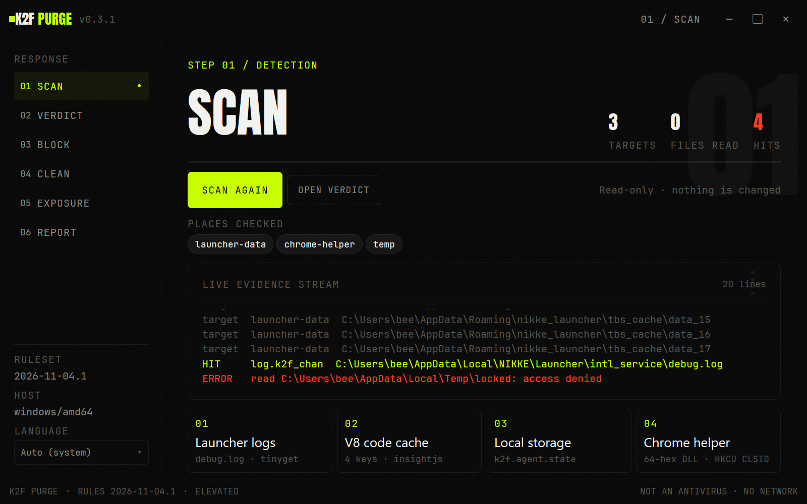
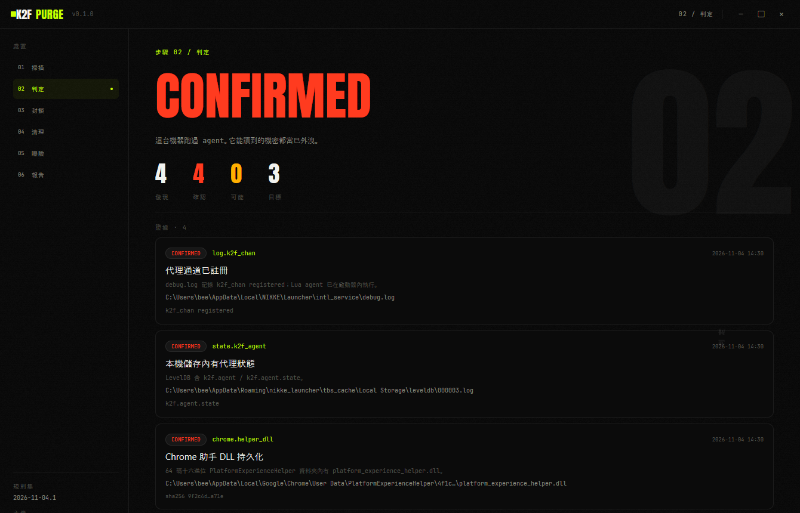
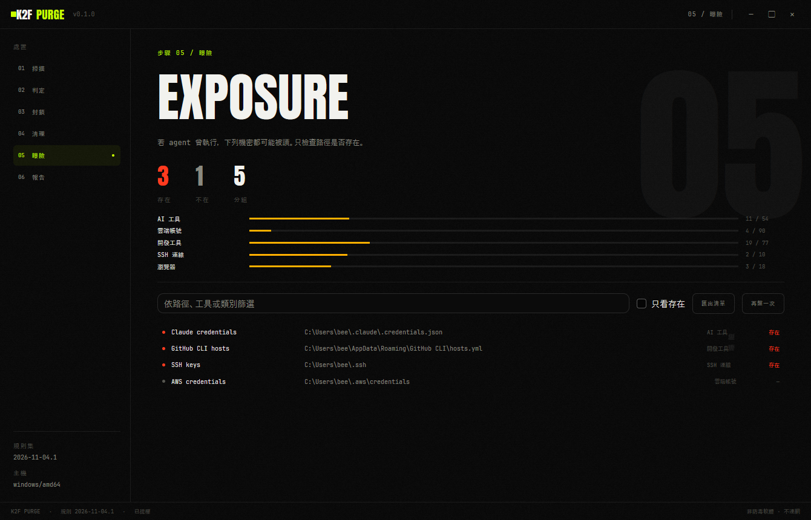
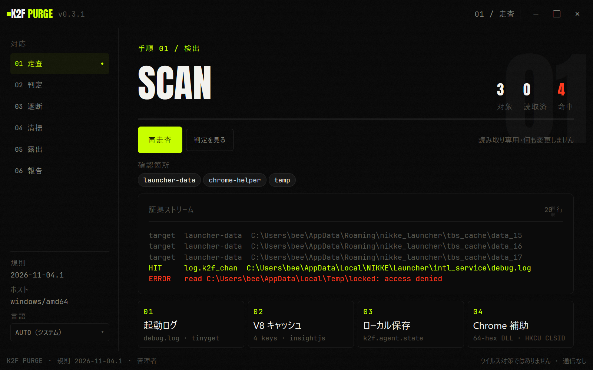

# K2F PURGE

[English](README.md) · [繁體中文](README.zh-Hant.md) · **日本語**

NIKKE PC ランチャーのサプライチェーン侵害に対するオフラインのインシデント対応ツールです。

**ソースとリリース：** [owogametools/K2F-Purge](https://github.com/owogametools/K2F-Purge) · [Releases](https://github.com/owogametools/K2F-Purge/releases)

**公開済みの指標を見つける。インフラを遮断する。落ちたものを隔離する。持ち出された可能性を洗い出す。マシンの外には何も出さない。**

K2F PURGE は Windows、Linux、macOS 向けのネイティブ Go デスクトップアプリです。ネットワーク通信は行いません。

| 走査 | 判定 | 露出 |
|---|---|---|
|  |  |  |

同じウィンドウの日本語 UI：



## 何が起きたか

2026-09-27 から 2026-11-03 にかけて、Level Infinite の CDN 上の公式 JavaScript 4 ファイルが改ざんされ、NIKKE PC ランチャー経由で遠隔操作エージェントを読み込むようになりました。ランチャーが開いている間、エージェントはランチャーのプロセス内でコマンド実行、ファイル読み取り、画面キャプチャ、資格情報の収集ができました。Windows の永続化には Chrome が読み込む DLL と `HKCU` CLSID が使われました。Linux と Steam Deck の利用者は、Wine/Proton がマップするホームディレクトリ経由で影響を受けました。

4 ファイルのうち 3 つは 2026-11-03 に差し替えられました。4 つ目は origin ではクリーンでしたが、同日遅くに一部の CDN ノードが旧版を配信していました。ファイルを差し替えても、エージェントが実行済みのマシンはきれいにならず、ランチャーのキャッシュに残った旧コピーも消えません。

独立したインシデントレポートは [docs/incident-report.zh-Hant.md](docs/incident-report.zh-Hant.md)（繁体字中国語）です。攻撃チェーン、時系列、IOC、影響、手動対応手順をまとめています。

## 機能

| ページ | 動作 | マシンへの変更 |
|---|---|---|
| **SCAN** | 既知の NIKKE ランチャーのデータ／インストールフォルダーと Wine/Proton プレフィックスを読み取り専用で走査します：`debug.log`、tinyget ログ、V8 code-cache キー、LevelDB／ローカルストレージ、Chrome `PlatformExperienceHelper` DLL、`HKCU` CLSID、一時ファイル、既知ハッシュ。各検出にはパス、ルール ID、サニタイズ済みスニペット（最大 160 文字）、可能なら SHA-256、mtime が付きます。 | なし |
| **VERDICT** | 検出を `CONFIRMED`、`LIKELY`、`INCONCLUSIVE`、`CLEAR_OF_LISTED_IOCS` に集約し、結果の隣に走査の限界を表示します。 | なし |
| **BLOCK** | hosts ファイルに `insightjs.com`、`www.insightjs.com`、`analytics.insightjs.com`、`insightjs.org`、`www.insightjs.org` を固定し、`89.127.233.127` と `89.126.250.172` への外向き通信を遮断します。Windows は名前付き `netsh` ルール、Linux は `nftables` テーブルと systemd unit（iptables フォールバック付き）、macOS は `pf` anchor と LaunchDaemon を使います。適用後に検証します。削除は本ツールのマーカーブロックと、自身のルール、anchor、永続化ファイルだけを消します。 | hosts のマーカーとバックアップ、ファイアウォールルール |
| **CLEAN** | 前回の走査から dry-run 計画を作ります。既定は `<user config dir>/K2F PURGE/quarantine/<timestamp>/` への隔離で、`manifest.json` と SHA-256 名のコピーを含みます。項目は選択できます。隔離一覧から復元・削除が可能です。完全削除には `PURGE` の入力が必要です。レジストリは単一の `HKCU` CLSID のみで、先に `.reg` を書き出します。`HKLM` は拒否します。ロックされた DLL はコピーするか、`MoveFileExW` で再起動時の削除を予約します。 | ファイルを隔離へ移動、選択した `HKCU` キーを削除 |
| **EXPOSURE** | 公開 `target-paths.md` から作った 290 項目のカタログを確認します：環境変数、SSH/GPG、ブラウザープロファイル、クラウド CLI、AI ツール、開発ツール、shell 履歴、ウォレット、プロジェクトフォルダー。既定ではメタデータのみを確認し、`Lstat`、glob 展開、ディレクトリ列挙で存在／不在、サイズ、mtime を報告します（ファイルは開きません）。明示的に選んだ場合だけ動く内容スキャンが 2 つあります：**内容をスキャン** は API key／secret ルールを適用して完全な値を表示し、**漏洩内容を表示** は同梱の AstrLink Guard モデルで秘密情報と個人情報を一覧します（こちらも完全な値）。どちらも symlink、バイナリ、大きすぎるファイルを除外し、ファイル数／件数／読取量の上限があります。端末内のみ。Markdown のローテーション用チェックリスト（繁体字中国語）を書き出せます。 | なし（保存したチェックリスト／レポートを除く） |
| **REPORT** | ローカルの Markdown レポート（繁体字中国語）と機械可読な JSON レポートを書き出します。検出、操作、遮断状態、清掃結果、露出サマリー、限界を含みます。 | 選択したディレクトリ内のファイル |

スキャナーは既知のルート内だけを読みます。ディスク全体は走査せず、ファイルごとのサイズ上限（既定 128 MB）とスコープごとのファイル数上限を適用します。Windows 専用チェック（Chrome ヘルパー DLL とレジストリ）は他プラットフォームではスキップされ、走査の限界に表示されます。組み込みルールセットは `2026-11-04.1`（`internal/ioc/rules.json` からコンパイル）。

2 つの露出内容アクションは自動では動きません。**内容をスキャン** は 290 項目のカタログのうち存在する `file`、glob 展開結果、環境変数が指すファイルだけを読み（ディレクトリやレジストリ項目は読みません）、symlink、バイナリ、バイナリ拡張子リスト、8 MiB 超のファイルを除外し、4,096 ファイル、2,000 件、64 MiB 読取で停止します。**漏洩内容を表示** は同梱の int8 モデルで同じファイル一覧をより厳しい上限（1 ファイル 256 KiB、合計 8 MiB、512 window）で走査します。完全な secret 値は UI と、利用者が保存したチェックリスト／レポートに現れます。アプリのログとエラーメッセージはマスク値のみです。モデルは release に同梱され（約 37 MiB）、実行時にダウンロードしません。モデルがない場合は理由を表示し、推論は行いません。

## 安全モデル

K2F PURGE は IOC ベースです。`CLEAR_OF_LISTED_IOCS` は、スキャナーが見られた範囲でこのレポートの指標が一致しなかったという意味であり、マシンがクリーンという意味ではありません。

以下は行いません：

- `HKLM` 配下の変更・削除；
- `PlatformExperienceHelper` の親フォルダーの削除（`platform_experience_helper.dll` を含む 64 桁 hex の子だけを削除）；
- UI からの任意パスの受け入れ：清掃パスはアプリが導出し、symlink 脱出チェック付きの許可リストで再確認します；
- shell の実行、コマンド文字列の補間、昇格チャネル経由の任意コマンド受け入れ；
- 既定の露出確認でカタログ内ファイルの内容を読むこと。opt-in の **内容をスキャン** と **漏洩内容を表示** は存在するカタログ項目だけを読み、symlink、バイナリ、サイズ上限超のファイルを除外します；
- 完全な secret 値をログやエラーメッセージに書くこと。完全な値は UI と、利用者が明示的に保存したチェックリスト／レポートにだけ現れます；
- ルール、更新などのダウンロード。テレメトリ、クラッシュ報告、自動更新はありません；
- パスワード変更、token 失効、ウォレット資金の移動；
- 選択していない清掃項目への操作。

フッターには `NOT AN ANTIVIRUS · NO NETWORK` を表示します（中国語・日本語 UI では翻訳されます）。

## 権限

**Windows：** 起動時に `ShellExecuteW("runas")` で昇格して自身を再起動します。UAC を拒否した場合は限られた権限で続行します。走査、露出、レポートは引き続き動作し、遮断と清掃は管理者権限が必要な箇所で失敗します。

**Linux と macOS：** GUI は root で再起動しません。フッターには `ADMIN ON DEMAND` を表示します（中国語・日本語 UI では翻訳されます）。バイナリには許可リスト方式の `--elevated-op` トランスポートが入っています：Linux は `pkexec`（失敗時は `sudo -n`）、macOS は `osascript ... with administrator privileges` で、JSON 許可リストと 120 秒のタイムアウトがあります。アプリが root でないとき、遮断操作はこの経路を使います。清掃はプロセス内で実行され、利用者の権限でランチャーファイルを移動できますが、管理者権限が必要な操作は失敗を報告します。走査、露出、レポートに昇格は不要です。

## ダウンロード

リリースビルドは [GitHub Releases](https://github.com/owogametools/K2F-Purge/releases) に添付されます。リリースのアーカイブには検証済みの AstrLink Guard モデルファイルがバイナリの隣に含まれ、アプリの実行時に何もダウンロードしません。ソースとリリースのリポジトリは [owogametools/K2F-Purge](https://github.com/owogametools/K2F-Purge) で公開されています。バイナリを検証する最も直接的な方法はソースからのビルドです。

## ビルド

要件：Go 1.27.3。`go.mod` の `tool` ディレクティブが mygo ビルドツールを固定します。Node、npm、webview、cgo は不要です。

```sh
go test ./...
sh scripts/fetch-astrlink.sh   # Linux/macOS；Windows は pwsh -File scripts/fetch-astrlink.ps1
go tool mygo build
```

リリースのパッケージングには取得手順が必要です。3 つのモデルファイルを `resources/astrlink-guard/7216b6a3b897/` に置き、サイズと SHA-256 を検証し、既に正しいファイルはスキップします。`mygo build` は `resources/` を exe の隣へコピーし、NSIS インストーラーにも入れます。モデルがなくてもビルドはできますが、**漏洩内容を表示** はモデルが利用できないと報告します。

Windows では次を生成します：

- `build/windows-amd64/K2F PURGE.exe`
- `build/windows-amd64/k2f-purge-setup-0.3.2-amd64.exe`（NSIS インストーラー）

クロスコンパイル：

```sh
go tool mygo build -platform linux/amd64
go tool mygo build -platform darwin/universal
```

署名済み macOS `.app`／`.dmg` は macOS 上で作成する必要があります。Linux 向けに mygo ツールを実行すると tarball、Debian パッケージ、PKGBUILD も生成されます。Windows に NSIS がない場合、mygo ビルドツールが取得します。これはビルド時の処理で、アプリの動作ではありません。

0.3.2 リリース時点で、Windows の `go test ./...` は成功します。`GOOS=linux go build ./...` と `GOOS=darwin go build ./...` も完了します。

## 自分で検証する

手順別の確認——ルールセット比較、テスト、ネットワーク import の grep、遮断計画の確認、隔離 manifest、外向き通信の監視、HKCU 限定の確認——は [docs/verification.md](docs/verification.md) にあります。

- [PRIVACY.md](PRIVACY.md)：ディスクに何をどこへ書くか。
- [SECURITY.md](SECURITY.md)：脅威モデル、非目標、脆弱性報告。
- [THIRD_PARTY_NOTICES.md](THIRD_PARTY_NOTICES.md)：magpie（MIT）と AstrLink Guard モデル（Apache-2.0）の表示。
