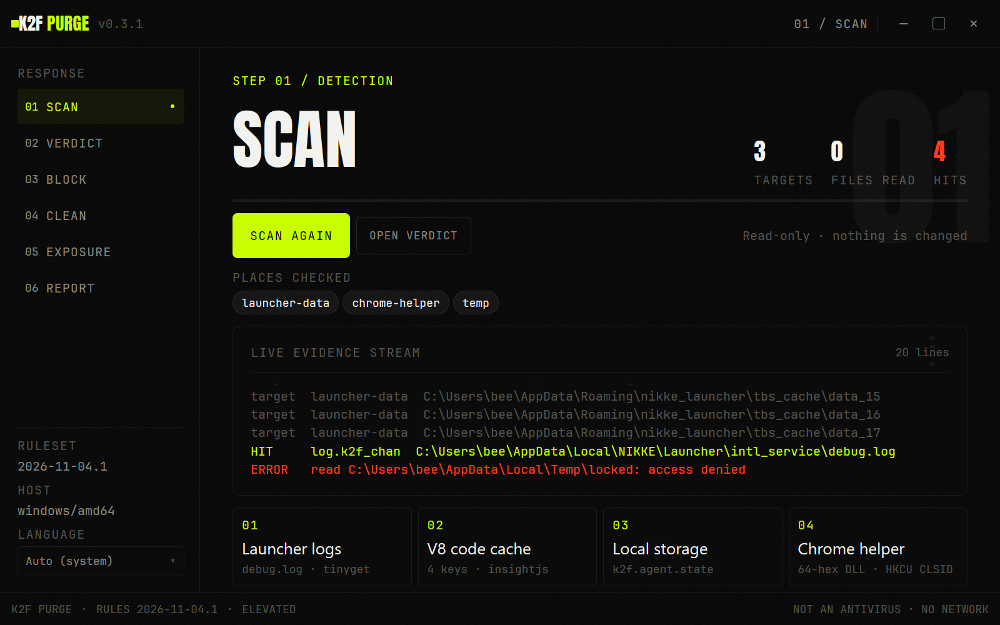
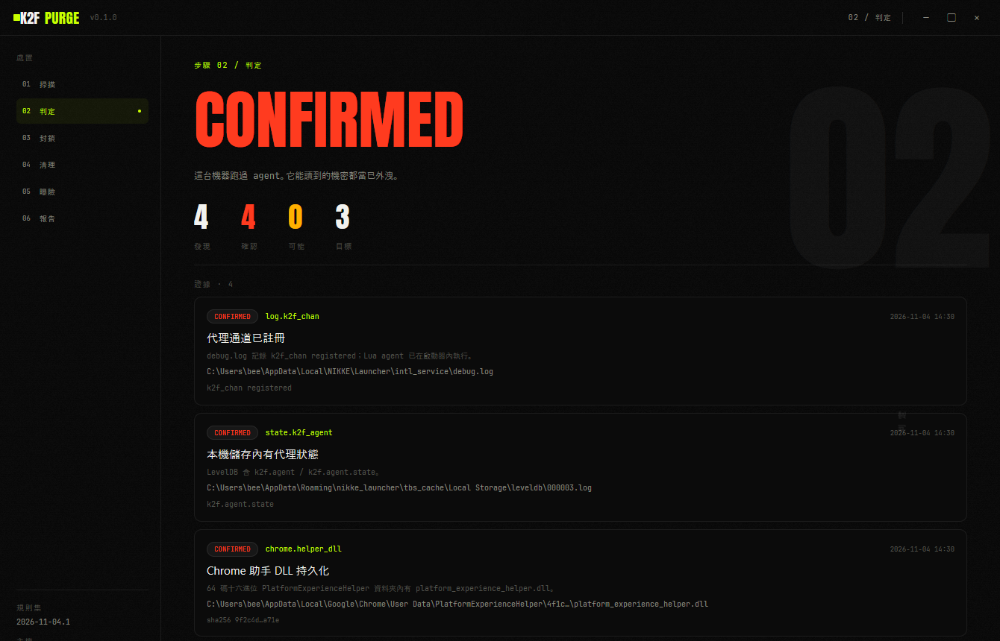
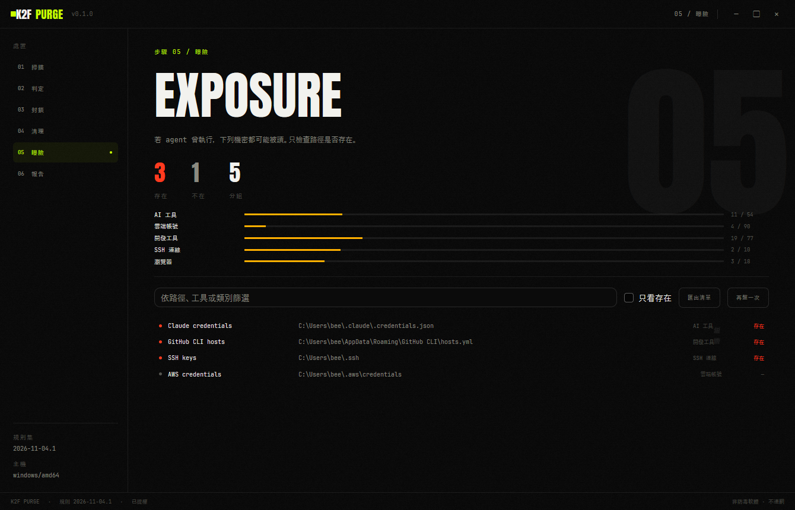
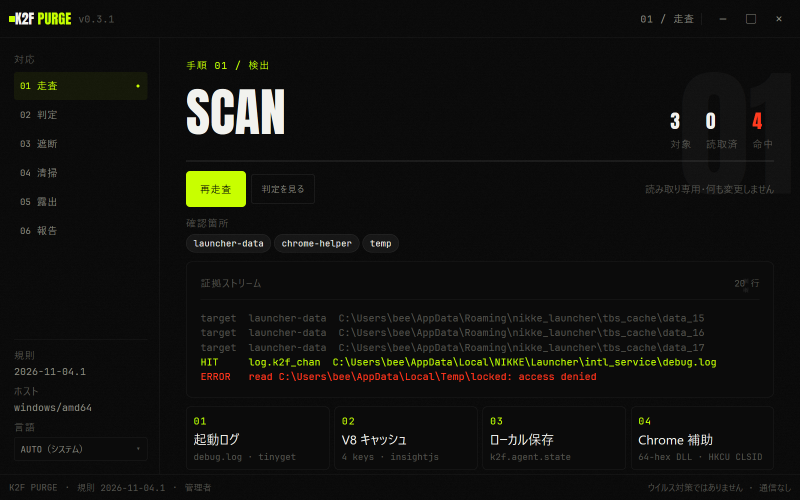

# K2F PURGE

**English** · [繁體中文](README.zh-Hant.md) · [日本語](README.ja.md)

Offline incident response for the NIKKE PC launcher supply-chain compromise.

**Source and releases:** [owogametools/K2F-Purge](https://github.com/owogametools/K2F-Purge) · [Releases](https://github.com/owogametools/K2F-Purge/releases)

**Find the listed indicators. Block the infrastructure. Quarantine what landed. Inventory what may have been taken. Nothing leaves the machine.**

K2F PURGE is a native Go desktop app for Windows, Linux, and macOS. It makes no network calls.

| Scan | Verdict | Exposure |
|---|---|---|
|  |  |  |

The same window in Japanese:



## What happened

From 2026-09-27 to 2026-11-03, four official JavaScript files on Level Infinite's CDN were modified to load a remote-control agent through the NIKKE PC launcher. While the launcher was open, the agent could run commands, read files, take screenshots, and collect credentials inside the launcher's process. Windows persistence used a Chrome-loaded DLL and an `HKCU` CLSID. Linux and Steam Deck players were exposed through Wine/Proton's mapped home directory.

Three of the four files were replaced on 2026-11-03. The fourth was clean at origin, but some CDN nodes were still serving the old version later that day. Replacing a file does not clean a machine where the agent already ran, and it does not remove old copies from the launcher cache.

The standalone incident report is [docs/incident-report.zh-Hant.md](docs/incident-report.zh-Hant.md) (Traditional Chinese). It documents the attack chain, timeline, IOCs, impact, and manual response steps.

## What it does

| Page | What happens | Changes to the machine |
|---|---|---|
| **SCAN** | Read-only pass over the known NIKKE launcher data and install folders, plus Wine/Proton prefixes: `debug.log`, tinyget logs, V8 code-cache keys, LevelDB/local storage, Chrome `PlatformExperienceHelper` DLLs, the `HKCU` CLSID, temp artifacts, and known hashes. Each finding carries a path, rule ID, sanitized snippet (up to 160 characters), SHA-256 where available, and mtime. | None |
| **VERDICT** | Rolls findings into `CONFIRMED`, `LIKELY`, `INCONCLUSIVE`, or `CLEAR_OF_LISTED_IOCS`, with the scan's limits shown next to the result. | None |
| **BLOCK** | Pins `insightjs.com`, `www.insightjs.com`, `analytics.insightjs.com`, `insightjs.org`, and `www.insightjs.org` in the hosts file, and drops `89.127.233.127` and `89.126.250.172` outbound. Windows uses named `netsh` rules. Linux uses an `nftables` table plus a systemd unit, with an iptables fallback. macOS uses a `pf` anchor plus a LaunchDaemon. Apply verifies the result. Remove deletes only this tool's marker block and its own rules, anchors, and persistence files. | Hosts marker and backup; firewall rules |
| **CLEAN** | Builds a dry-run plan from the last scan. The default action is quarantine under `<user config dir>/K2F PURGE/quarantine/<timestamp>/`, with `manifest.json` and SHA-256-named copies. Items are selectable. Restore and purge are available from the quarantine list. Permanent deletion requires typing `PURGE`. Registry work is limited to the single `HKCU` CLSID, with a `.reg` export first; `HKLM` is refused. Locked DLLs are copied or scheduled for deletion at reboot with `MoveFileExW`. | Moves files to quarantine; deletes the selected `HKCU` key |
| **EXPOSURE** | Checks a 290-entry catalog derived from the public `target-paths.md`: environment variables, SSH/GPG, browser profiles, cloud CLIs, AI tools, dev tools, shell history, wallets, and project folders. The default check is metadata-only: `Lstat`, glob expansion, and directory enumeration report present/absent, size, and mtime without opening files. Two explicit opt-in actions read the catalogue files that exist: **Scan contents** applies API-key/secret rules with full values shown; **Show leaked content** runs the bundled AstrLink Guard model and lists secrets and personal data with full values shown. Both skip symlinks, binaries, and oversized files and enforce file/finding/byte caps. Local only. Exports a Markdown rotation checklist (Traditional Chinese). | None, apart from the checklist or report you choose to save |
| **REPORT** | Writes a local Markdown report (Traditional Chinese) and a machine-readable JSON report with findings, actions, block state, clean results, exposure summary, and limitations. | Files in the directory you choose |

The scanner only reads within its known roots. It does not walk the whole disk, and it enforces a per-file size cap (128 MB by default) and a per-scope file cap. Windows-only checks (Chrome helper DLL and registry) are skipped on other platforms and listed in the scan limitations. The embedded ruleset is version `2026-11-04.1`, compiled in from `internal/ioc/rules.json`.

The two exposure content actions never start on their own. **Scan contents** reads only existing `file`, glob-expanded, and environment-variable-pointed entries from the 290-entry catalogue (not directories or registry keys), skips symlinks, binary files, a binary extension list, and files over 8 MiB, and stops at 4,096 files, 2,000 findings, or 64 MiB read. **Show leaked content** runs the bundled int8 model over the same file list with tighter limits (256 KiB per file, 8 MiB total, 512 windows). Complete secret values appear in the interface and in a checklist or report you save; application logs and error messages contain masked values only. The model is included in release archives (about 37 MiB) and is never downloaded at runtime; if it is missing, the button reports the reason and runs nothing.

## Safety model

K2F PURGE is IOC-based. `CLEAR_OF_LISTED_IOCS` means none of the indicators in this report matched where the scanner could look. It does not mean the machine is clean.

It will not:

- modify or delete anything under `HKLM`;
- delete the `PlatformExperienceHelper` parent folder (only a 64-hex child containing `platform_experience_helper.dll`);
- accept an arbitrary path from the interface: cleanup paths are derived by the app and re-checked against an allowlist, with symlink-escape checks;
- run a shell, interpolate a command string, or accept arbitrary commands through the elevated-op channel;
- read catalogue file contents during the default exposure check; the opt-in **Scan contents** and **Show leaked content** actions read only existing catalogue entries and skip symlinks, binaries, and files over the size limits;
- write full secret values to a log or error message; full values appear in the interface and in the checklist or report you explicitly save;
- download rules, updates, or anything else, and it has no telemetry, crash reporting, or auto-update;
- change passwords, revoke tokens, or move wallet funds;
- act on cleanup items you did not select.

The footer carries a `NOT AN ANTIVIRUS · NO NETWORK` notice (translated when the interface is Chinese or Japanese).

## Privileges

**Windows:** at startup the app calls `ShellExecuteW("runas")` to relaunch itself elevated. If you decline the UAC prompt, it continues with limited rights. Scanning, exposure, and reporting still work; block and clean actions fail where they need administrator access.

**Linux and macOS:** the GUI is never restarted as root. The footer shows `ADMIN ON DEMAND` (translated when the interface is Chinese or Japanese). The binary contains a whitelisted `--elevated-op` transport: `pkexec` with a `sudo -n` fallback on Linux, and `osascript ... with administrator privileges` on macOS, with a JSON whitelist and a 120-second timeout. Block operations use this transport when the app is not root. Clean runs in-process: it can move your launcher files as your user, but anything that needs administrator rights reports a failure. Scan, exposure, and report do not require elevation.

## Download

Release builds are attached to [GitHub Releases](https://github.com/owogametools/K2F-Purge/releases). Release archives include the verified AstrLink Guard model files next to the binary; nothing is downloaded at application runtime. The source and release repository is public at [owogametools/K2F-Purge](https://github.com/owogametools/K2F-Purge). Building from source is the most direct way to verify a binary.

## Build

Requirements: Go 1.27.3. The `tool` directive in `go.mod` pins the mygo build tool. No Node, npm, webview, or cgo is involved.

```sh
go test ./...
sh scripts/fetch-astrlink.sh   # Linux/macOS; on Windows: pwsh -File scripts/fetch-astrlink.ps1
go tool mygo build
```

The fetch step is needed for release packaging. It downloads the three model files into `resources/astrlink-guard/7216b6a3b897/`, verifies size and SHA-256, and skips files that are already valid. `mygo build` copies `resources/` next to the exe and into the NSIS installer. Without the model the app still builds, but **Show leaked content** reports that the model is unavailable.

On Windows this writes:

- `build/windows-amd64/K2F PURGE.exe`
- `build/windows-amd64/k2f-purge-setup-0.3.2-amd64.exe` (NSIS installer)

Cross-compilation:

```sh
go tool mygo build -platform linux/amd64
go tool mygo build -platform darwin/universal
```

A signed macOS `.app`/`.dmg` must be produced on macOS. Running the mygo tool for Linux also produces a tarball, Debian package, and PKGBUILD. If NSIS is not installed on Windows, the mygo build tool downloads it; that is a build-time step, not application behavior.

At the 0.3.2 release, `go test ./...` passes on Windows. `GOOS=linux go build ./...` and `GOOS=darwin go build ./...` also complete.

## Verify it yourself

Step-by-step checks - ruleset comparison, tests, network-import grep, block-plan inspection, quarantine manifest, egress monitoring, and HKCU-only verification - are in [docs/verification.md](docs/verification.md).

- [PRIVACY.md](PRIVACY.md): what is written to disk and where.
- [SECURITY.md](SECURITY.md): threat model, non-goals, and vulnerability reporting.
- [THIRD_PARTY_NOTICES.md](THIRD_PARTY_NOTICES.md): magpie (MIT) and AstrLink Guard model (Apache-2.0) notices.
