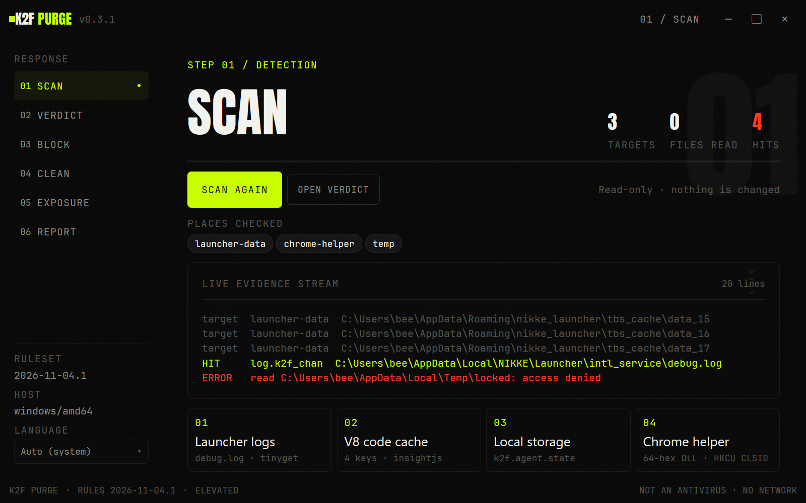
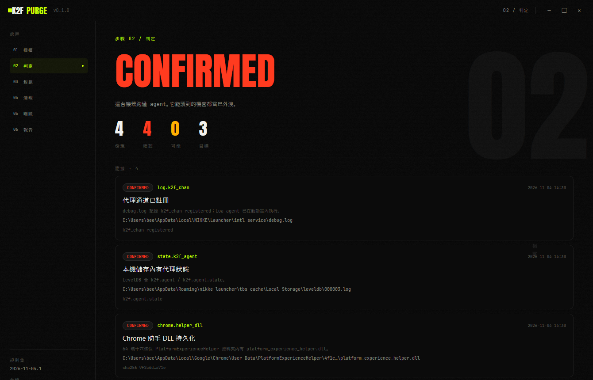
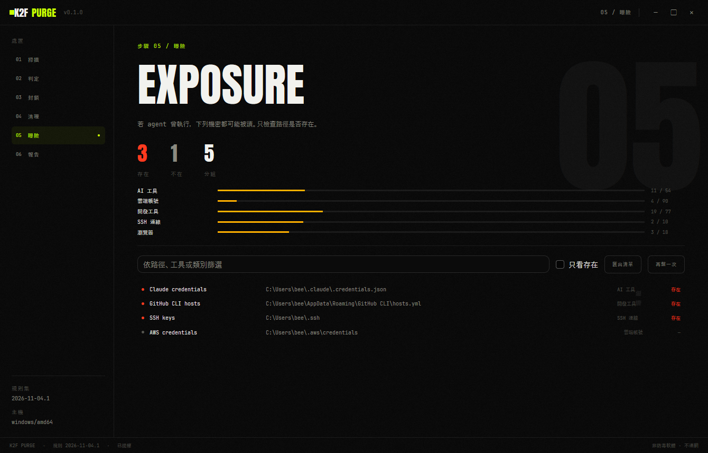
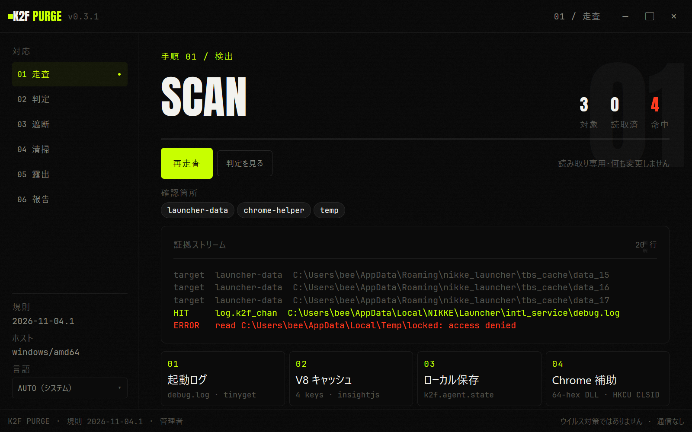

# K2F PURGE

[English](README.md) · **繁體中文** · [日本語](README.ja.md)

NIKKE PC 啟動器供應鏈投毒的離線應變工具。

**原始碼與發佈：** [owogametools/K2F-Purge](https://github.com/owogametools/K2F-Purge) · [Releases](https://github.com/owogametools/K2F-Purge/releases)

**找出已公開的指標。封鎖基礎設施。隔離已落地的東西。盤點可能被拿走的資料。不讓任何東西離開這台機器。**

K2F PURGE 是原生 Go 桌面應用程式，支援 Windows、Linux 與 macOS。程式不發任何網路請求。

| 掃描 | 判定 | 曝險 |
|---|---|---|
|  |  |  |

同一個視窗的日文介面：



## 事件經過

2026-09-27 到 2026-11-03，Level Infinite CDN 上四個官方 JavaScript 檔被修改，透過 NIKKE PC 啟動器載入遠端控制 agent。啟動器開著時，agent 可在啟動器行程內執行命令、讀取檔案、擷取畫面、收集憑證。Windows 持久化使用 Chrome 載入的 DLL 與 `HKCU` CLSID。Linux 與 Steam Deck 玩家則經由 Wine/Proton 映射的家目錄暴露。

四個檔案中，三個已於 2026-11-03 被替換。第四個在 origin 已是乾淨版，但當天稍晚仍有部分 CDN 節點提供舊版。替換檔案不會清掉已執行過 agent 的機器，也不會移除啟動器快取裡的舊副本。

獨立事件報告是 [docs/incident-report.zh-Hant.md](docs/incident-report.zh-Hant.md)（繁體中文），記錄攻擊鏈、時間線、IOC、影響與手動應變步驟。

## 功能

| 頁面 | 作用 | 對機器的變更 |
|---|---|---|
| **SCAN** | 對已知的 NIKKE 啟動器資料與安裝資料夾，以及 Wine/Proton prefix 做只讀掃描：`debug.log`、tinyget 日誌、V8 code-cache keys、LevelDB／本機儲存、Chrome `PlatformExperienceHelper` DLL、`HKCU` CLSID、暫存產物與已知雜湊。每個發現都帶路徑、規則 ID、去識別化片段（最多 160 字元）、可用時的 SHA-256 與 mtime。 | 無 |
| **VERDICT** | 把發現歸納成 `CONFIRMED`、`LIKELY`、`INCONCLUSIVE` 或 `CLEAR_OF_LISTED_IOCS`，並在結果旁顯示本次掃描限制。 | 無 |
| **BLOCK** | 在 hosts 檔固定 `insightjs.com`、`www.insightjs.com`、`analytics.insightjs.com`、`insightjs.org`、`www.insightjs.org`，並擋掉 `89.127.233.127` 與 `89.126.250.172` 的出站連線。Windows 使用具名 `netsh` 規則。Linux 使用 `nftables` 表加 systemd unit，並以 iptables 備援。macOS 使用 `pf` anchor 加 LaunchDaemon。套用後會驗證結果。移除只刪除本工具的標記區塊與自己的規則、anchor、持久化檔。 | Hosts 標記與備份；防火牆規則 |
| **CLEAN** | 依上次掃描建立 dry-run 計畫。預設動作是隔離到 `<user config dir>/K2F PURGE/quarantine/<timestamp>/`，內含 `manifest.json` 與以 SHA-256 命名的副本。項目可選取。可從隔離清單還原或清除。永久刪除需輸入 `PURGE`。登錄檔只處理單一 `HKCU` CLSID，且先匯出 `.reg`；`HKLM` 一律拒絕。被鎖定的 DLL 會先複製，或以 `MoveFileExW` 排程在重開機後刪除。 | 把檔案移到隔離區；刪除所選 `HKCU` 機碼 |
| **EXPOSURE** | 檢查由公開 `target-paths.md` 衍生的 290 條目錄：環境變數、SSH/GPG、瀏覽器設定檔、雲端 CLI、AI 工具、開發工具、shell 歷史、錢包與專案資料夾。只回報存在／不存在、大小與 mtime，從不讀取檔案內容。可匯出 Markdown 輪替清單（繁體中文）。 | 無；除非你選擇儲存清單 |
| **REPORT** | 寫出本機 Markdown 報告（繁體中文）與機器可讀 JSON 報告，包含發現、動作、封鎖狀態、清理結果、曝險摘要與限制。 | 你選擇的目錄中的檔案 |

掃描器只在已知根目錄內讀取。它不會走遍整顆磁碟，並套用單檔大小上限（預設 128 MB）與每個範圍的檔案數上限。Windows 專用檢查（Chrome 輔助 DLL 與登錄檔）在其他平台會略過，並列在掃描限制中。內嵌規則集版本是 `2026-11-04.1`，由 `internal/ioc/rules.json` 編譯進來。

## 安全模型

K2F PURGE 是以 IOC 為基礎。`CLEAR_OF_LISTED_IOCS` 代表在掃描器能查看的範圍內，這份報告的指標都沒有命中；不代表機器乾淨。

它不會：

- 修改或刪除 `HKLM` 下的任何東西；
- 刪除 `PlatformExperienceHelper` 上層資料夾（只刪含 `platform_experience_helper.dll` 的 64 碼十六進位子資料夾）；
- 接受介面傳來的任意路徑：清理路徑由應用程式推導，並再次比對允許清單，含 symlink 逃逸檢查；
- 執行 shell、插值命令字串，或透過提權通道接受任意命令；
- 在曝險檢查中讀取憑證或錢包檔案內容；
- 下載規則、更新或任何東西；沒有遙測、當機回報或自動更新；
- 變更密碼、撤銷 token 或移動錢包資金；
- 處理你沒有選取的清理項目。

頁尾會顯示 `NOT AN ANTIVIRUS · NO NETWORK`（中文或日文介面時已翻譯）。

## 權限

**Windows：** 啟動時應用程式呼叫 `ShellExecuteW("runas")` 以提權重新啟動自己。若拒絕 UAC 提示，會以有限權限繼續。掃描、曝險與報告仍可使用；封鎖與清理在需要系統管理員權限時會失敗。

**Linux 與 macOS：** GUI 不會以 root 重啟。頁尾顯示 `ADMIN ON DEMAND`（中文或日文介面時已翻譯）。二進位檔內含白名單式 `--elevated-op` 通道：Linux 用 `pkexec`，失敗時退回 `sudo -n`；macOS 用 `osascript ... with administrator privileges`，並有 JSON 白名單與 120 秒逾時。應用程式不是 root 時，封鎖操作會走這條通道。清理在行程內執行：可以用你的使用者權限移動啟動器檔案，但需要系統管理員權限的動作會回報失敗。掃描、曝險與報告不需要提權。

## 下載

發佈版本會附在 [GitHub Releases](https://github.com/owogametools/K2F-Purge/releases)。原始碼與發佈倉庫公開於 [owogametools/K2F-Purge](https://github.com/owogametools/K2F-Purge)。從原始碼建置是驗證二進位檔最直接的方式。

## 建置

需求：Go 1.27.3。`go.mod` 的 `tool` 指令固定 mygo 建置工具版本。不需要 Node、npm、webview 或 cgo。

```sh
go test ./...
go tool mygo build
```

Windows 上會產生：

- `build/windows-amd64/K2F PURGE.exe`
- `build/windows-amd64/k2f-purge-setup-0.2.1-amd64.exe`（NSIS 安裝程式）

交叉編譯：

```sh
go tool mygo build -platform linux/amd64
go tool mygo build -platform darwin/universal
```

簽署過的 macOS `.app`／`.dmg` 必須在 macOS 上產生。對 Linux 執行 mygo 工具也會產生 tarball、Debian 套件與 PKGBUILD。Windows 上若未安裝 NSIS，mygo 建置工具會下載它；這是建置階段行為，不是應用程式行為。

在 Windows、0.2.1 版本，`go test ./...` 回報 12 個套件共 110 個測試通過。`GOOS=linux go build ./...` 與 `GOOS=darwin go build ./...` 也能完成。

## 自行驗證

逐步檢查——規則集比對、測試、網路 import grep、封鎖計畫檢視、隔離 manifest、外連監控、HKCU-only 驗證——見 [docs/verification.md](docs/verification.md)。

- [PRIVACY.md](PRIVACY.md)：哪些內容寫入磁碟、寫到哪裡。
- [SECURITY.md](SECURITY.md)：威脅模型、非目標與漏洞回報。
